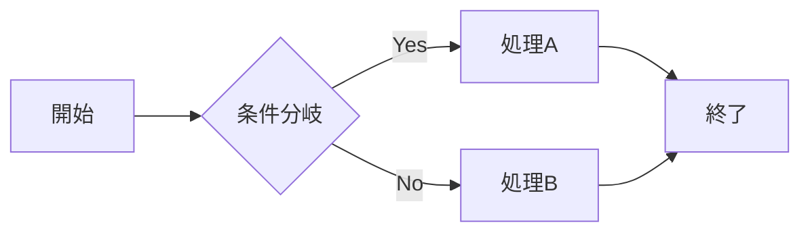
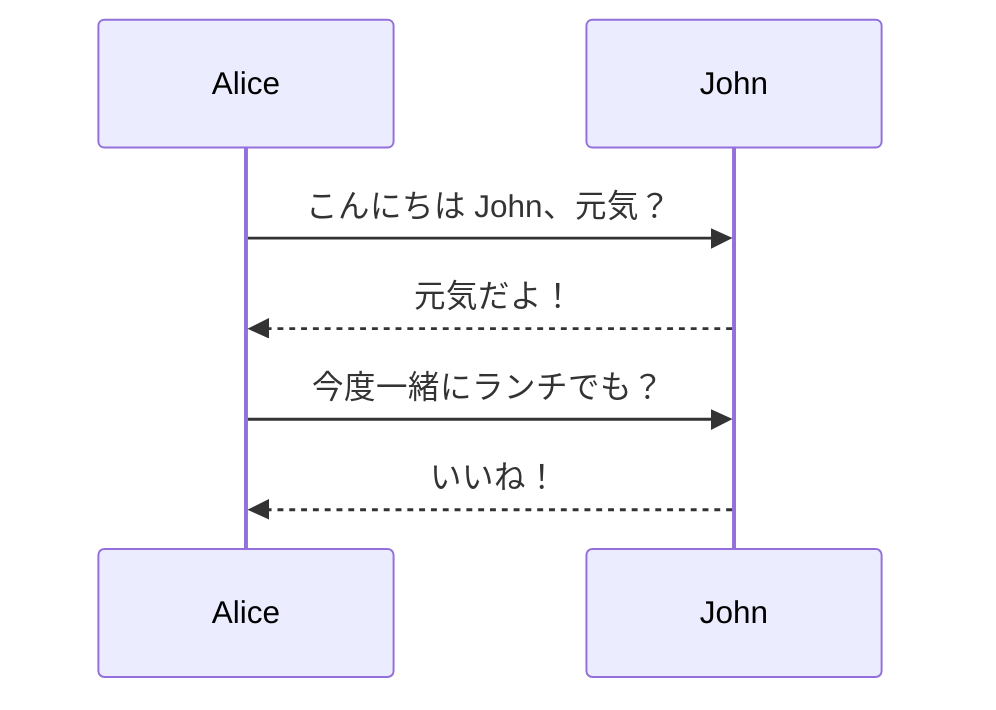
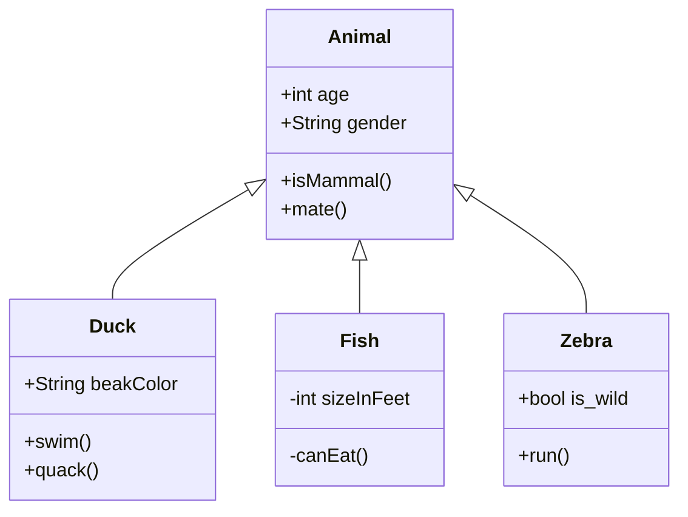
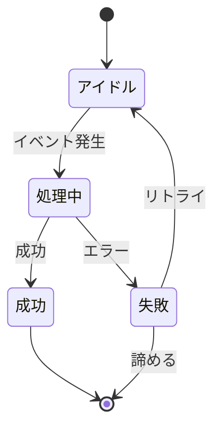
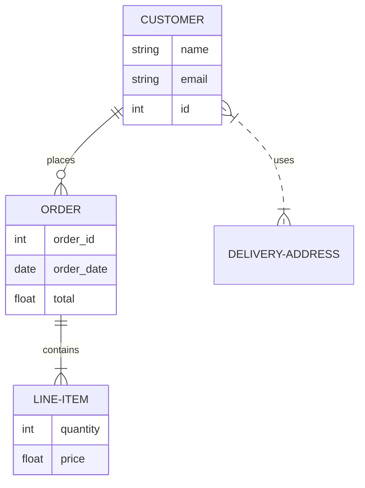
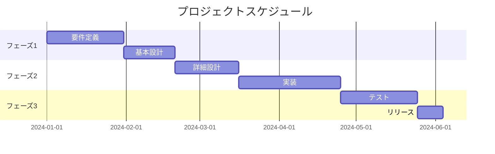
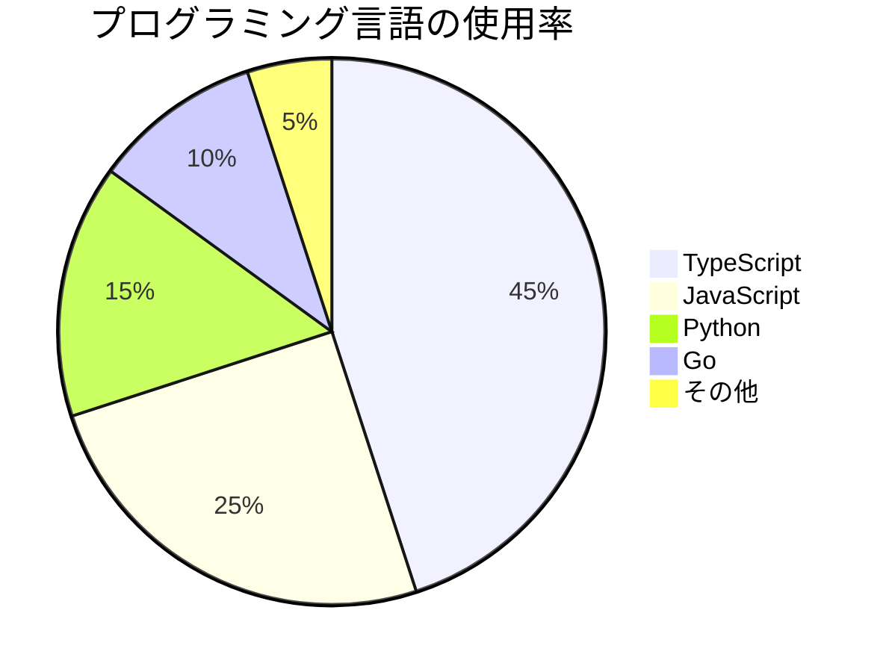
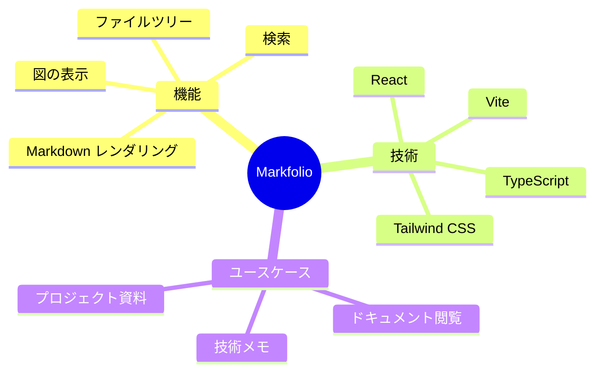
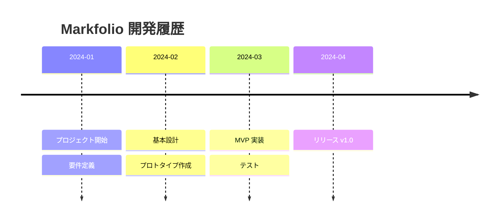
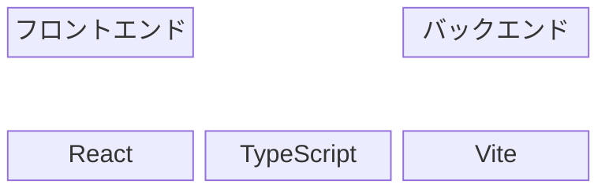

# 図のサンプル集

Markfolio でサポートされる Mermaid と BPMN 図のサンプルです。

## Mermaid 図

Mermaid は、テキストベースで様々な種類の図を作成できるツールです。

## フローチャート

## シーケンス図

## クラス図

## 状態遷移図

## ER 図

## ガントチャート

## 円グラフ

## マインドマップ

## タイムライン

## ブロック図

---

## BPMN 図

BPMN (Business Process Model and Notation) は、ビジネスプロセスを視覚化するための標準的な記法です。

### BPMN の特徴

- **ビジネスプロセスの可視化**: 業務フローを図で表現
- **標準化された記法**: 国際標準（ISO/IEC 19510）
- **実行可能な定義**: ワークフローエンジンで実行可能

### BPMN ファイルサンプル

以下のBPMNファイルをクリックして、実際の図を確認できます：

- [シンプルなプロセス](./bpmn/simple-process.bpmn) - 基本的な承認フロー
- [スイムレーンプロセス](./bpmn/swimlane-process.bpmn) - 複数の担当者による協調作業

### BPMN の使い方

BPMN ファイル（`.bpmn`）は、左のファイルツリーから選択するか、上記のリンクをクリックして表示できます。

**BPMN ファイルの作成方法:**

- [bpmn.io](https://bpmn.io/) などのBPMNモデリングツールで作成
- 作成したファイルを `.bpmn` 拡張子で保存
- ドキュメントディレクトリに配置

---

## 参考リンク

- [Mermaid 公式ドキュメント](https://mermaid.js.org/) - Mermaid の詳細な仕様
- [BPMN 2.0 仕様](https://www.omg.org/spec/BPMN/2.0/) - BPMN の公式仕様
- [bpmn.io](https://bpmn.io/) - BPMN モデリングツール
