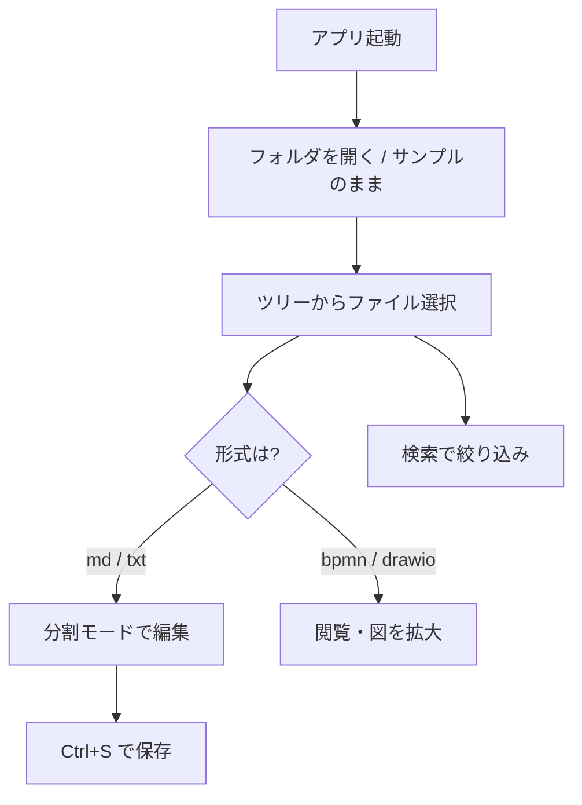

# Markfolio の使い方

Markfolio は、ローカルフォルダ内のドキュメントをすばやく開いて読む・書くためのデスクトップアプリです。Markdown を中心に、図（Mermaid / BPMN / draw.io）もそのまま表示できます。

---

## 画面の見かた

起動すると、だいたい次のレイアウトになります。

| 場所 | 役割 |
|------|------|
| 上部メニュー | `ファイル` → ドキュメントフォルダを開く |
| ヘッダー | サイドバー表示切替、検索、テーマ（ライト/ダーク） |
| 左サイドバー | ファイルツリー。「再読み込み」でディスクの最新状態を取り込み |
| 右メイン | ドキュメントの閲覧・編集エリア（パンくず＋本文） |

サイドバーはヘッダー左の ≡ で隠したり出せたりします。狭い画面では隠すと本文が広く使えます。

---

## ドキュメントフォルダを開く

最初は同梱サンプル（この `docs`）が開いていることが多いです。自分の資料を見るときは次のいずれかです。

1. **メニュー**  
   `ファイル` → `フォルダーを開く` でフォルダを選ぶ  
2. **ドラッグ＆ドロップ**  
   エクスプローラーから **フォルダ** または **対応ファイル** をウィンドウへ落とす  
   - フォルダ → そのフォルダをルートとして開く  
   - ファイル → 親フォルダをルートにし、そのファイルを開く  

一度開いたフォルダは覚えておくので、次回起動時も同じ場所から再開できます。

> フォルダが非常に大きい場合、表示件数に上限がかかり、画面上に警告が出ることがあります。そのときは対象を狭いフォルダに絞って開き直してください。

---

## ファイルを閲覧する

1. 左ツリーでファイルをクリックする  
2. 右ペインに内容が表示される  
3. 上部のパンくず（`root / ... / ファイル名`）でいまの位置が分かる  

### 対応している形式

| 形式 | 拡張子 | 閲覧 | 編集 |
|------|--------|:----:|:----:|
| Markdown | `.md` / `.markdown` | ○ | ○ |
| プレーンテキスト | `.txt` | ○ | ○ |
| BPMN | `.bpmn` | ○ | ×（閲覧のみ） |
| draw.io | `.drawio` / `.dio` | ○ | ×（閲覧のみ） |

Markdown は GitHub Flavored Markdown（表、チェックリスト、コードブロックなど）に対応しています。  
` ```mermaid ` フェンスで書いた図は本文中に描画されます。

---

## 編集する（Markdown / テキスト）

編集できるのは **`.md` / `.markdown` / `.txt`** です。該当ファイルを開くと、パンくずの右にモード切替が出ます。

| モード | 説明 |
|--------|------|
| **閲覧** | プレビューだけ。読むときに使う |
| **編集** | エディタだけ。がっつり書くときに使う |
| **分割** | 左がエディタ・右がライブプレビュー（開いたときの既定） |

分割の中央の細い線をドラッグすると、左右の幅を変えられます。  
プレビューは入力後わずかに遅れて更新されます（図の描画負荷を抑えるため）。

### 保存と破棄

| 操作 | 方法 |
|------|------|
| 保存 | `Ctrl + S`、または「保存」ボタン |
| 変更を捨てる | 「破棄」ボタン（確認あり） |

未保存のときはファイル名の横に `•` が付きます。  
未保存のまま別ファイルを開く・フォルダを切り替える・アプリを閉じようとすると、確認ダイアログが出ます。

> ブラウザだけのプレビュー起動（`npm run dev`）ではファイルへ保存できません。保存はデスクトップ版（`npm run tauri:dev` またはインストール版）で行ってください。

---

## 図の見かた・操作

### Markdown 内の Mermaid

コードブロックで図を書けます。

````markdown

````

### フルスクリーン

Mermaid や BPMN などの図の右上にある拡大アイコンをクリックすると、大きく表示できます。

| 操作 | 動作 |
|------|------|
| Shift + ドラッグ | 図を移動（パン） |
| マウスホイール | ズームイン / アウト |
| `+` / `-` | ズーム（Mermaid） |
| `0` | 元の大きさに戻す（Mermaid） |
| `Esc` または × | フルスクリーンを閉じる |

### BPMN / draw.io

- **BPMN**（`.bpmn`）… プロセス図として表示。閲覧専用  
- **draw.io**（`.drawio`）… 表示にインターネット接続が必要です。ファイルが極端に大きい場合は埋め込み表示できないことがあります  

サンプルは `examples/bpmn/` と `examples/drawio/` にあります。

---

## 検索

ヘッダー中央の「ドキュメントを検索...」に文字を入れると、次を対象に絞り込みます。

- ファイル名  
- パス（相対パス）  
- ファイル本文（少し待ってから本文も検索）  

2 文字以上入れると本文検索が走ります。ツリーにヒットしたファイルだけが残ります。

---

## テーマ

ヘッダー右端のアイコンで **ライト ↔ ダーク** を切り替えられます。設定は次回起動にも残ります。

---

## よくある操作の流れ



1. 自分のドキュメントフォルダを開く  
2. ツリーまたは検索でファイルを見つける  
3. Markdown なら分割で書きながらプレビューを確認  
4. `Ctrl + S` で保存  
5. 図は拡大表示で細部を確認  

---

## 次に見るサンプル

- [図の例（Mermaid）](./examples/mermaid/diagram-examples.md)  
- [BPMN サンプル一覧](./examples/bpmn/README.md)  
- [概要 README](./README.md)  
